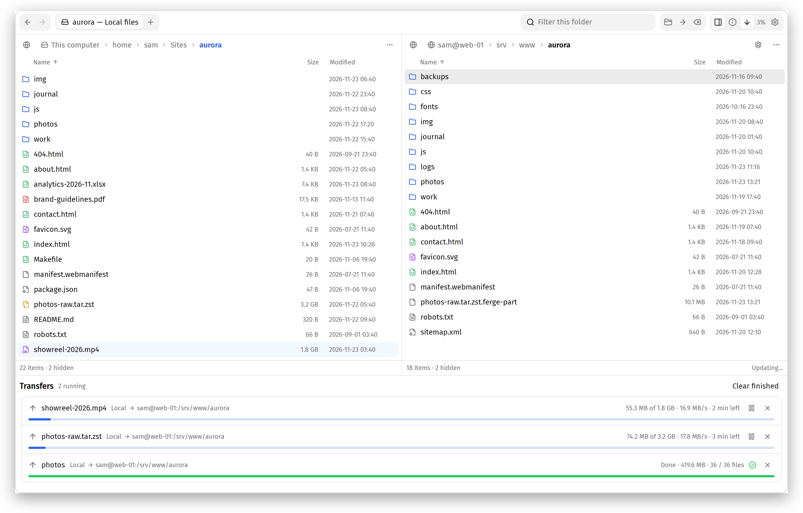
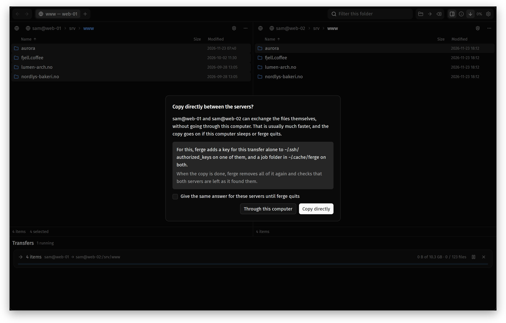
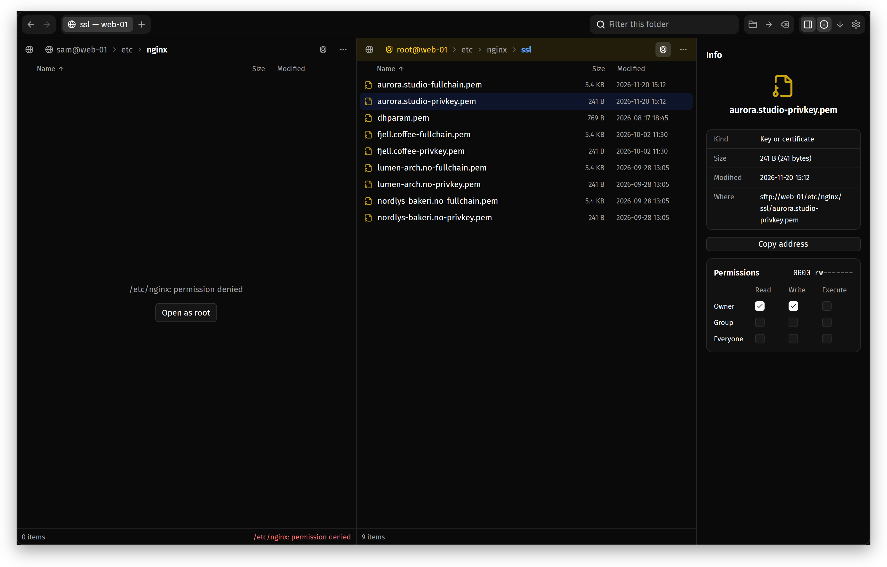
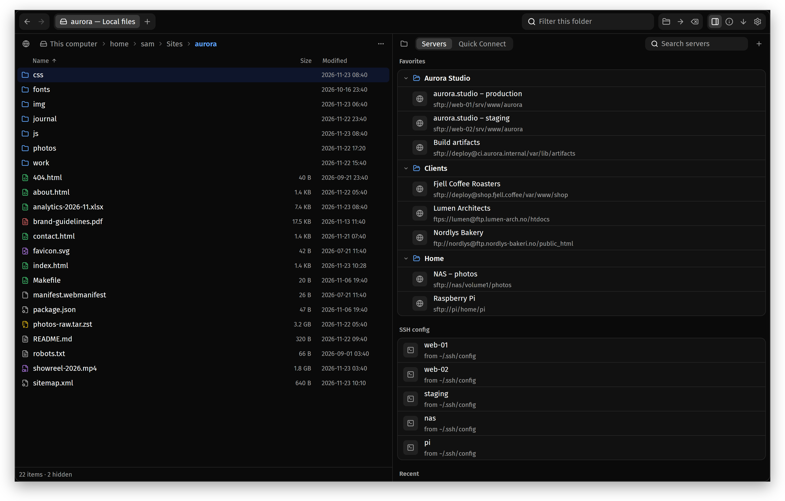
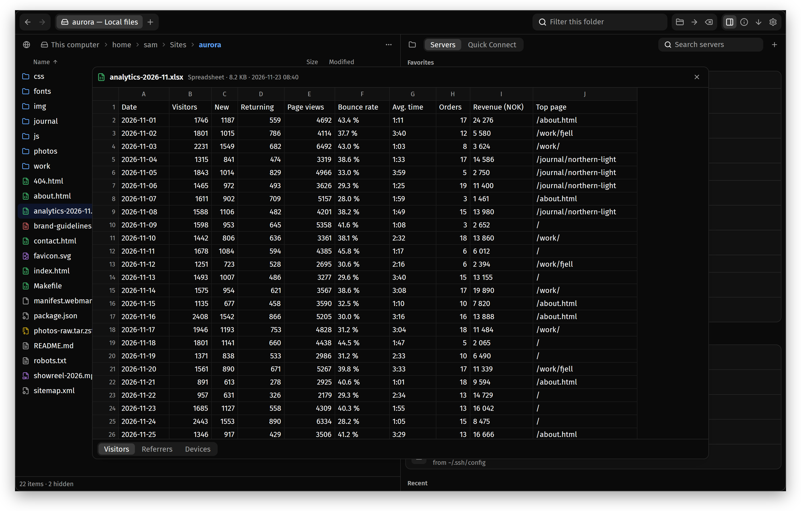
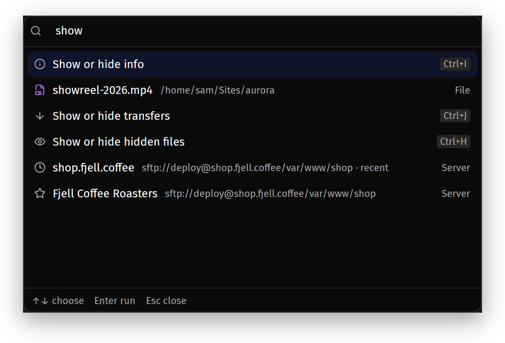

<div align="center">


# ferge

**A fast, keyboard-first file transfer client for Linux and macOS.**<br>
SFTP, FTP and FTPS in a native app that never makes you wait, copies straight from server to
server and works as root through sudo.

[](https://github.com/wirecurl/ferge/actions/workflows/ci.yml)
[](https://github.com/wirecurl/ferge/releases/latest)
[](LICENSE)


[Install](#install) · [Features](#features) · [Keyboard](#keyboard) · [Building](#from-source) · [Changelog](CHANGELOG.md)

</div>

<br>

<picture>
  <source media="(prefers-color-scheme: dark)" srcset="docs/screenshots/hero-dark.png">
  
</picture>

## Why ferge

- **Fast where it counts.** Folders with 100,000 entries scroll, sort and filter without
  dropping a frame. Listings stream in while the server is still sending, and every network and
  disk operation stays off the UI thread.
- **Transfers you can trust.** Pause in the middle of a file, quit, come back tomorrow: ferge
  picks up where it stopped. Nothing is overwritten without asking, and half-written files never
  appear under their real name.
- **Server to server, directly.** Two SSH servers exchange the files themselves instead of
  everything going down to your computer and up again, and the copy goes on when your laptop
  sleeps.
- **Root without a root login.** Open `/etc` and other folders your account cannot read, as root
  through sudo, with nothing to set up on the server.
- **Made for the keyboard.** Every action has a key, the command palette finds commands, servers,
  tabs and files, and type-to-filter works in every folder.
- **At home on your system.** Your `~/.ssh/config`, keys, agent and `known_hosts` just work;
  passwords go to the desktop keyring; fonts, theme and font size follow the desktop.
- **Free software**, written in Rust with [GPUI](https://www.gpui.rs/), licensed under the GPL.

## Features

### Two panes, any direction

This computer on the left, a server on the right, in as many tabs as you like. Copy with
<kbd>Ctrl</kbd>+<kbd>C</kbd> / <kbd>Ctrl</kbd>+<kbd>V</kbd>, press <kbd>F5</kbd> to send the
selection to the other side, or drag and drop, also to and from your desktop's file manager.
Uploads, downloads and copies between two servers all go through the same queue: up to four
files in parallel, with progress, speed and time left.

### Server to server, without the detour



Moving sites to a new server usually means downloading everything and uploading it again, through
your own internet connection. ferge lets two SSH servers exchange the files themselves instead:
one of them pushes or the other pulls, whichever can reach the other, at the speed of their
network. The copy goes on when your laptop sleeps or ferge quits, and ferge follows it again when
it starts.

Nothing is left behind. For the job, ferge adds a key that can do nothing but this one job and
expires, removes it when the copy is done and checks that both servers are exactly as it found
them. Where the servers cannot reach each other, the copy simply goes through this computer.

### Root without a root login



Your account cannot open `/etc/nginx`, and like most servers, this one refuses root logins.
On any SSH server where your account may use sudo, **Open as root** switches the pane to root in
the same folder. Nothing to set up on the server: ferge runs `sftp-server` through `sudo` on the
connection it already has and only asks for a password if sudo needs one. Upload, rename, delete
and change permissions as root, without copying to `/tmp` first and moving things into place over
SSH. The tinted header reminds you while it lasts, and the inspector (<kbd>Ctrl</kbd>+<kbd>I</kbd>)
shows the details of the selection and lets you change permissions.

### Your servers, one keystroke away



Favorites in folders, every host from `~/.ssh/config`, recent connections and Quick Connect in
one panel. Start typing to search, press <kbd>Enter</kbd> to connect.

### Look inside files, even on servers



Press <kbd>Space</kbd> to preview the selected file, and keep moving through the folder with the
arrow keys. ferge shows text, images, spreadsheets (`xlsx`, `ods`, `csv`, …), Word, PowerPoint
and OpenDocument files and PDF pages, all built in and all the same for files on a server.
Documents are read in a separate, memory-limited process, so a damaged or hostile file cannot
take ferge down.

### Everything from the keyboard

<p align="center">
  
</p>

<kbd>Ctrl</kbd>+<kbd>K</kbd> opens the command palette: commands with their shortcuts, servers,
tabs and the files of open folders, all in one search. See [Keyboard](#keyboard) for the full
list.

### And also

- **SFTP** via [russh](https://github.com/Eugeny/russh): agent, key files (with passphrase
  prompt), password and keyboard-interactive login. `~/.ssh/config` with aliases, `ProxyCommand`,
  `IdentityFile`, `Include`, `Match all` and more. Reads and writes are pipelined over separate
  data channels, so transfers never block browsing.
- **FTP and FTPS** (explicit and implicit TLS) with resumable transfers. Certificates the system
  does not trust are shown with their names, validity and fingerprint before ferge connects.
- **Strict host key checking** with OpenSSH semantics: hashed names, wildcards, `@revoked`.
  Unknown keys are confirmed, changed keys are refused.
- **Safe transfers:** files are written as `name.ferge-part` and renamed when complete, keeping
  their modification time. Existing files and folders are asked about: replace, skip, keep both
  or merge. Transfers continue after a lost connection and after a restart.
- **Saved passwords** in the Secret Service (GNOME Keyring, KeePassXC, KWallet) or the macOS
  Keychain, or in a file encrypted with Argon2id and XChaCha20-Poly1305. A password is only saved
  after it worked.
- **File operations:** new folder and file, rename in place, duplicate, delete, copy address.
- **Native on Linux:** Wayland and X11, light and dark following the desktop, the desktop's fonts
  via the XDG portal, server-side decorations on compositors such as niri.

## Install

Every release has packages on the [releases page](https://github.com/wirecurl/ferge/releases):

| System | How |
|---|---|
| **macOS** 11+, Apple silicon and Intel | `brew install --cask wirecurl/tap/ferge`, or the `.dmg` |
| **Debian, Ubuntu** 22.04+ | `sudo apt install ./ferge_0.1.0_amd64.deb` |
| **Fedora, openSUSE** | `sudo dnf install ./ferge-0.1.0-1.x86_64.rpm` (or `zypper install`) |
| **Arch, CachyOS** | `makepkg -si` in [`packaging/aur/ferge`](packaging/aur/ferge) |
| **Any other Linux** with glibc 2.35+ | `tar -xzf ferge-0.1.0-x86_64-linux.tar.gz -C ~/.local --strip-components=1` |

Packages for aarch64 Linux are there as well. On Linux, ferge draws with Vulkan; Mesa provides a
driver for most graphics cards.

ferge is not signed with an Apple Developer ID yet, so macOS asks before the first start: allow it
under System Settings → Privacy & Security → Open Anyway.

### From source

Building needs [rustup](https://rustup.rs/), which installs the compiler version pinned in
`rust-toolchain.toml` by itself. On Linux, ferge also needs a Vulkan driver and these libraries:

```sh
# Arch
sudo pacman -S --needed libxkbcommon libxkbcommon-x11 wayland fontconfig freetype2 libxcb \
    vulkan-icd-loader
# Debian, Ubuntu
sudo apt install pkg-config libxkbcommon-dev libxkbcommon-x11-dev libwayland-dev \
    libfontconfig-dev libfreetype-dev libx11-xcb-dev libxcb1-dev libvulkan1
```

Then:

```sh
cargo install --locked --path crates/ferge-app
install -Dm644 packaging/linux/com.wirecurl.ferge.desktop ~/.local/share/applications/com.wirecurl.ferge.desktop
mkdir -p ~/.local/share/icons && cp -r packaging/linux/icons/hicolor ~/.local/share/icons/
# If ~/.cargo/bin is not on the PATH of your desktop session, use an absolute Exec= path:
sed -i "s|^Exec=ferge|Exec=$HOME/.cargo/bin/ferge|" ~/.local/share/applications/com.wirecurl.ferge.desktop
```

## Usage

```sh
ferge                                   # this computer on the left, the servers on the right
ferge myserver                          # an ssh_config alias, opened on the right
ferge sftp://alice@example.org:2222/srv # user, port and start directory
ferge ftps://alice@ftp.example.org/www  # FTP over TLS (ftp:// asks the server for TLS first)
ferge /var/log                          # local folder
ferge -F ./ssh_config myserver          # use another SSH client configuration
```

## Keyboard

The essentials: arrow keys and <kbd>Enter</kbd> to move around, type to filter,
<kbd>Space</kbd> to preview, <kbd>F5</kbd> to copy to the other side, <kbd>Tab</kbd> to switch
sides, <kbd>Ctrl</kbd>+<kbd>K</kbd> for everything else.

<details>
<summary>All shortcuts</summary>

| Key (Linux) | Key (macOS) | Action |
|---|---|---|
| ↑ ↓ PgUp PgDn Home End | same | move the selection |
| Shift with ↑ ↓ PgUp PgDn Home End, Shift-click, Ctrl-click, Ctrl+A | same with Shift, ⇧-click, ⌘-click, ⌘A | select several items |
| Insert, Ctrl+Space | Insert | mark or unmark the item and move down |
| Enter, →, Alt+↓ | Enter, →, ⌘↓ | open folder; on a file: preview |
| Backspace, ←, Alt+↑ | Backspace, ←, ⌘↑ | parent folder (Backspace edits the filter while one is active) |
| Alt+← / Alt+→ | ⌘[ / ⌘] | back / forward |
| any character, Ctrl+F | same, ⌘F | filter the folder; Esc clears |
| Ctrl+1 / 2 / 3 | ⌘1 / 2 / 3 | sort by name / size / date, again to reverse |
| Ctrl+R | ⌘R | refresh |
| F5, Ctrl+Shift+R | F5, ⌘⇧R | copy the selection to the other side (refresh with one pane) |
| Ctrl+C / Ctrl+V | ⌘C / ⌘V | copy items, paste (transfer) them into the current folder |
| Ctrl+Shift+N / Ctrl+Alt+N | ⌘⇧N / ⌘⌥N | new folder / new file |
| F2 | F2 | rename |
| Delete | ⌘⌫ | delete, after asking |
| Ctrl+D | ⌘D | duplicate |
| Ctrl+Shift+C | ⌘⇧C | copy the address of the selection |
| Ctrl+H | ⌘⇧. | show or hide hidden files |
| Ctrl+I | ⌘I | show or hide the inspector |
| Ctrl+L, Ctrl+Shift+G | ⌘L, ⌘⇧G | go to a folder or address |
| Ctrl+Shift+K | ⌘⇧K | switch a pane between its files and the servers |
| Ctrl+E | ⌘E | disconnect |
| Tab, Ctrl+Alt+← / → | Tab, ⌘⌥← / → | switch between the two sides |
| Ctrl+\\ | ⌘\\ | one or two file browsers |
| Ctrl+J | ⌘J | show or hide transfers |
| Ctrl+T / Ctrl+W | ⌘T / ⌘W | new tab / close tab |
| Alt+1 … Alt+8, Alt+9 | ⌥1 … ⌥8, ⌥9 | go to that tab, to the last tab |
| Ctrl+Tab, Ctrl+PgDn / Ctrl+Shift+Tab, Ctrl+PgUp | Ctrl+Tab, ⌘⇧] / Ctrl+Shift+Tab, ⌘⇧[ | next / previous tab |
| Ctrl+K | ⌘K | command palette: commands, servers, tabs and the files of open folders |
| Space | Space | preview the selected file (while no filter is typed) |
| Ctrl+, | ⌘, | settings |

In the server panel, type to search, use ↑ ↓ and press Enter to connect (Ctrl+Enter: new tab).
Favorites and folders are edited from their context menu or the + menu.

</details>

## Preview

ferge shows text and images, spreadsheets (`xlsx`, `xlsm`, `xlsb`, `ods`, `csv`, `tsv`) as a
grid with a tab per sheet, Word, PowerPoint and OpenDocument files (`docx`, `pptx`, `odt`, `odp`)
as their text with headings, lists and tables, and PDF pages. On macOS, Quick Look renders office
files, including older formats and Pages, Numbers and Keynote, as their programs would. Text is
read only from its start; documents up to 64 MB are read whole. Text in the preview can be
selected with the mouse and copied with Ctrl+C (⌘C); without a selection, Ctrl+C copies the
selected files as always.

## Settings

Settings live in `settings.toml` in the configuration directory (`~/.config/ferge` on Linux,
`~/Library/Application Support/ferge` on macOS). The settings window (Ctrl+, or the gear in the
toolbar) edits the same file, and edits made to the file in any editor take effect as soon as
it is saved. ferge keeps comments and the order of what is written by hand, and a file that is
a symbolic link (as in a dotfiles repository) stays one. A setting that is left out uses its
default; a value ferge cannot use is reported and ignored.

```toml
[appearance]
theme = "dark"               # "system" (default), "light" or "dark"
font = "Inter"               # interface font; default: the desktop's
font-size = 14               # in pixels, 6 to 32; default: the desktop's
mono-font = "JetBrains Mono" # fixed-width text; default: the desktop's
```

On Linux, "the desktop's" fonts come from the XDG desktop portal (the GNOME interface settings
that every portal backend provides), including the text scaling factor.

## Roadmap

ferge 0.1.0 is the first release: browsing, previews, file operations and transfers over SFTP,
with favorites, history, saved passwords and working as root. FTP and FTPS are done on `main`
and come with the next release. Next up are S3-compatible storage (AWS, R2, B2, MinIO) and
WebDAV, then folder sync with a dry run before anything changes. The full plan is in
[PLAN.md](PLAN.md).

## Development

See [CLAUDE.md](CLAUDE.md) for build, test and benchmark commands. In short:

```sh
cargo test --workspace
./testserver/up.sh && cargo test --workspace -- --include-ignored
cargo deny check                 # licenses and security advisories of all dependencies
cargo build --release && cargo run --release -p ferge-bench
./packaging/build.sh             # binary for packages and releases, without this machine's paths
```

CI runs formatting, clippy, the tests, the SFTP and FTP integration tests against the test
servers and `cargo deny` on every push to `main` and every pull request, and the macOS build on
`main`.

The workspace has three crates: `ferge-core` (protocols, transfers, listings; no UI),
`ferge-app` (the GPUI application) and `ferge-bench` (performance budget checks).

## License

ferge is free software: you can redistribute it and/or modify it under the terms of the
[GNU General Public License](LICENSE) as published by the Free Software Foundation, either
version 3 of the License, or (at your option) any later version.
